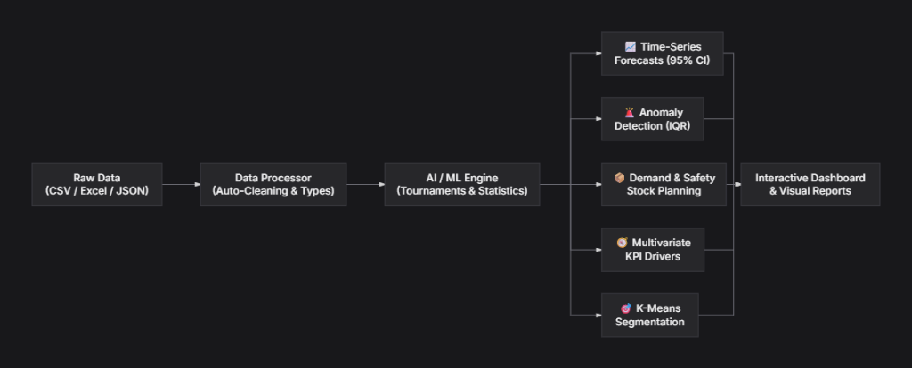
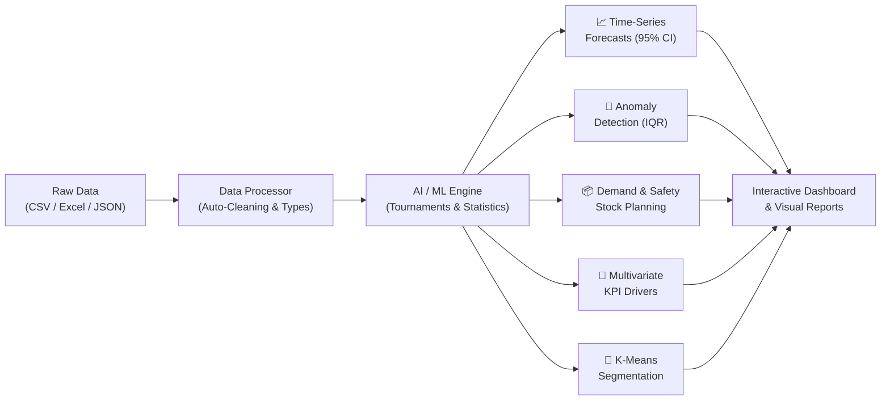

# 🧠 ML-Engine — AI-Powered Business Analytics & Forecasting

[](https://colab.research.google.com/github/ajeet3301/ML-Engine/blob/main/ML_Engine_Colab_Host.ipynb)
[](https://nextjs.org/)
[](https://react.dev/)
[](https://tailwindcss.com/)
[](https://developers.cloudflare.com/cloudflare-one/connections/connect-networks/)
[](https://opensource.org/licenses/MIT)

**ML-Engine** is an AI-powered, full-stack **Business Intelligence & Automated Predictive Analytics platform**. 

It allows anyone—from founders and business analysts to data teams—to upload raw business spreadsheets (CSV, Excel, or JSON) and immediately receive **machine learning forecasts, anomaly alerts, automated cohort segmentation, and driver analysis** through an interactive web dashboard without writing code.

---

## 🏗️ Architecture Pipeline





---

## 🌟 What It Does

When you drop a dataset into ML-Engine, it acts as an **autonomous data scientist** that performs five core analytical functions:

### 1. 🏆 Multi-Model Forecasting Tournament
Instead of relying on a single static curve or basic straight-line extrapolation, the engine runs an **automated tournament** between 4 competing predictive models for every time-series metric:
* **Holt’s Double Exponential Smoothing**: Tracks trend and level adjustments while filtering short-term noise. Features automated grid-search optimization for smoothing parameters ($\alpha \in [0.1, 0.7]$, $\beta \in [0.05, 0.3]$).
* **Polynomial Quadratic Regression**: Fits degree-2 parabolic curves ($y = ax^2 + bx + c$) via Cramer's Rule to identify acceleration, deceleration, and saturation plateaus.
* **Ordinary Least Squares (OLS) Linear Trend**: Standard baseline regression with $R^2$ evaluation.
* **Simple Exponential Smoothing (SES)**: For stationary, mean-reverting metrics.

The engine evaluates in-sample and out-of-sample error metrics ($R^2$, RMSE, MAE, MAPE) and selects the champion model, returning a **3-period future trajectory** with **95% Confidence Interval prediction bands** ($[Lower, Upper]$).

### 2. 🚨 Robust Anomaly & Outlier Detection
* Traditional tools rely on Gaussian standard deviation ($2.5\sigma$), which fails completely on skewed, Pareto-distributed business data.
* ML-Engine uses **Tukey’s Interquartile Range (IQR)** fences:
  $$\text{Fences} = [Q_1 - 1.5 \times IQR,\; Q_3 + 1.5 \times IQR]$$
* Combined with **Median Absolute Deviation (MAD)** modified Z-scores, it flags genuine operational anomalies (outages, fraud, sudden demand spikes) without false positives.

### 3. 📦 Intelligent Demand & Safety Stock Planning
* Groups transaction records by product/SKU and calculates demand velocity (run-rate).
* Determines **forecasted demand** adjusted for trend momentum.
* Computes statistical **Safety Stock** recommendations ($Z_{0.95} \times \sigma_{\text{demand}}$) and **Reorder Points** to prevent stockouts and eliminate dead inventory.

### 4. 🧭 Multivariate Driver & Correlation Analysis
* Automatically detects primary business KPIs (`Revenue`, `Sales`, `Profit`, `GMV`).
* Runs pairwise Pearson correlations and standardized regression coefficients ($\beta$) across all features to isolate the #1 positive driver and #1 negative drag.

### 5. 🎯 Unsupervised K-Means Auto-Segmentation
* Normalizes continuous multidimensional variables (Min-Max scaling) and executes K-Means clustering with $k\text{-means++}$ initialization.
* Labels cohorts into actionable business tiers (e.g. *Tier 1: High Volume / High Value*, *Tier 3: Niche / Premium Margin*).

---

## ⚙️ How It Works (Under the Hood)

ML-Engine is built on a modern full-stack TypeScript stack (**Next.js 16**, **React 19**, **Tailwind CSS v4**, and **Zustand**):

### Phase 1: Data Ingestion & Sanitization Layer
* **Module**: `src/lib/dataProcessor.ts`
* Uses `PapaParse` for CSVs and `SheetJS (xlsx)` for Excel workbooks.
* Performs automatic type inference (`number`, `string`, `date`, `boolean`), sanitizes missing/corrupted values, and computes data completeness scores.

### Phase 2: Pure Statistical Modeling Engine
* **Module**: `src/lib/aiEngine.ts`
* Runs client-side or server-side in JavaScript/TypeScript with pure mathematical routines—**no heavy Python environment, PyTorch, or GPU required**.
* Produces structured predictions, anomaly flags, demand plans, and driver correlations in milliseconds.

### Phase 3: Reactive State & Visualization
* **Module**: `src/lib/store.ts` & `src/app/dashboard/page.tsx`
* Zustand manages datasets, active filters, predictions, and insight streams.
* UI components display KPI metric cards, confidence progress bars, and prediction intervals with dark/light theme support.

### Phase 4: Zero-Config Cloud Tunnel
* **Module**: `ML_Engine_Colab_Host.ipynb`
* Runs directly inside free Google Colab instances and creates a high-speed **Cloudflare Quick Tunnel (`cloudflared`)**, exposing the web app with a global HTTPS URL (`https://*.trycloudflare.com`).

---

## 🏢 Real-World Use Cases

| Industry | Application |
| :--- | :--- |
| **E-Commerce & Retail** | Upload order logs to forecast SKU replenishment, calculate safety stock, and prevent stockouts. |
| **SaaS & Subscriptions** | Track user engagement trends, detect usage crashes (outages), and segment customers by usage tiers. |
| **Finance & Operations** | Detect fraudulent transaction spikes, identify cost drivers, and forecast quarterly cash flow. |

---

## ⚡ Run on Google Colab (One-Click Cloudflare Host)

You can launch and host the entire ML-Engine application with **zero setup** on your local machine:

[](https://colab.research.google.com/github/ajeet3301/ML-Engine/blob/main/ML_Engine_Colab_Host.ipynb)

1. Click the **Open in Colab** badge above or open [`ML_Engine_Colab_Host.ipynb`](./ML_Engine_Colab_Host.ipynb).
2. Click **Run** on the very first cell: **`⚡ Option A: ONE-CLICK ALL-IN-ONE LAUNCH (Recommended)`**.
3. The notebook will automatically:
   - Configure Node.js 20 LTS and download `cloudflared`.
   - Clone this repository and install all dependencies.
   - Launch the web server on port 3000.
   - Establish a secure Cloudflare Quick Tunnel and display your live public URL (`https://*.trycloudflare.com`).
4. Click the link to access your interactive web app from any device!

---

## 💻 Local Development

### Prerequisites
- Node.js 20+ installed
- Git

### Installation
```bash
# Clone the repository
git clone https://github.com/ajeet3301/ML-Engine.git
cd ML-Engine

# Install dependencies
npm install --legacy-peer-deps

# Run the development server
npm run dev
```

Open [http://localhost:3000](http://localhost:3000) in your browser.

---

## 📁 Project Structure

```
ML-Engine/
├── ML_Engine_Colab_Host.ipynb   # Ready-to-run Google Colab Notebook with Cloudflare Tunnel
├── public/
│   ├── pipeline.png             # Architecture pipeline diagram
│   └── favicon.ico              # App favicon
├── src/
│   ├── app/
│   │   ├── dashboard/           # Dashboard overview, file upload, settings
│   │   ├── layout.tsx, page.tsx # Root landing page and layout
│   │   └── globals.css          # Tailwind CSS styles
│   ├── components/
│   │   ├── dashboard/           # AI insights panel, KPI cards, quick actions
│   │   ├── layout/              # Sidebar, navbar, theme-provider
│   │   └── ui/                  # Radix UI + Tailwind primitives
│   ├── lib/
│   │   ├── aiEngine.ts          # Core Machine Learning & Forecasting Tournament Engine
│   │   ├── dataProcessor.ts     # Data parsing (CSV, Excel, JSON) & summary statistics
│   │   ├── store.ts             # Zustand global state
│   │   └── auth.ts & prisma.ts  # NextAuth & database adapter
│   └── types/                   # TypeScript interfaces
├── prisma/schema.prisma         # Prisma database schema
└── package.json                 # Project dependencies & scripts
```

---

## 📄 License

MIT License. Contributions and feedback are welcome!
